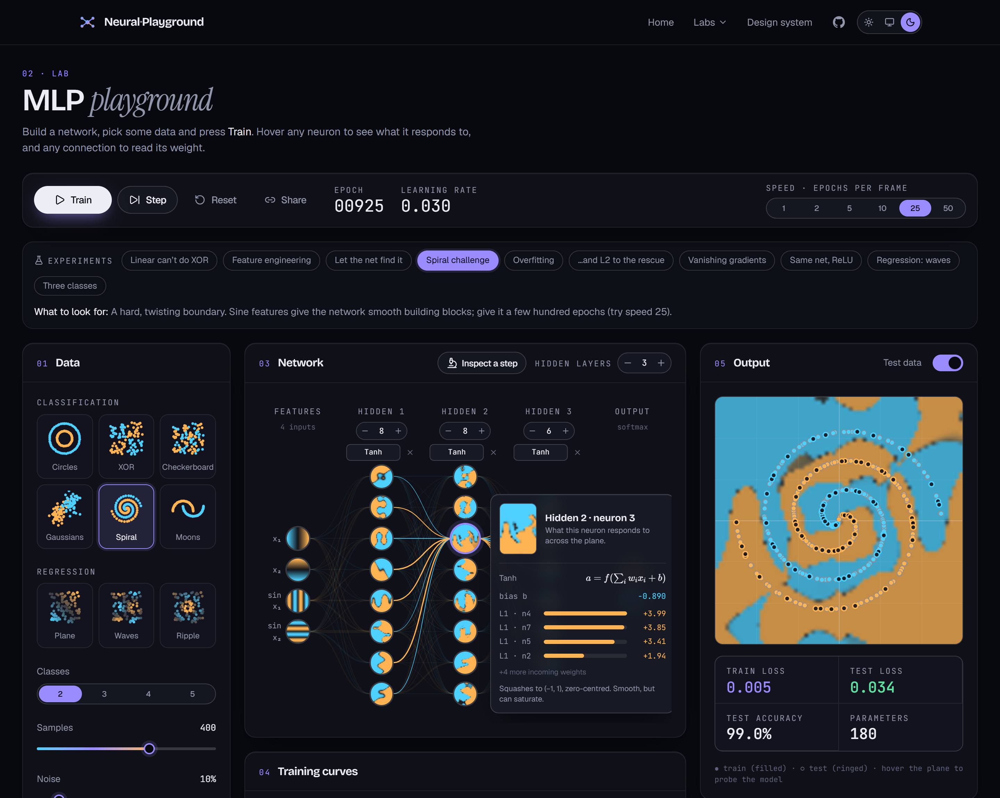
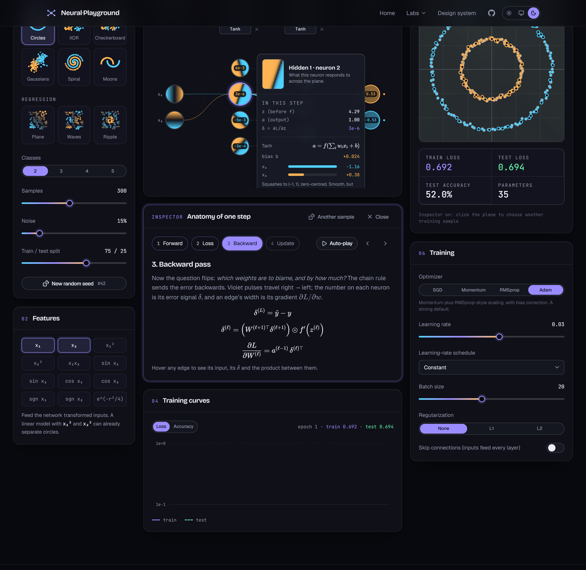
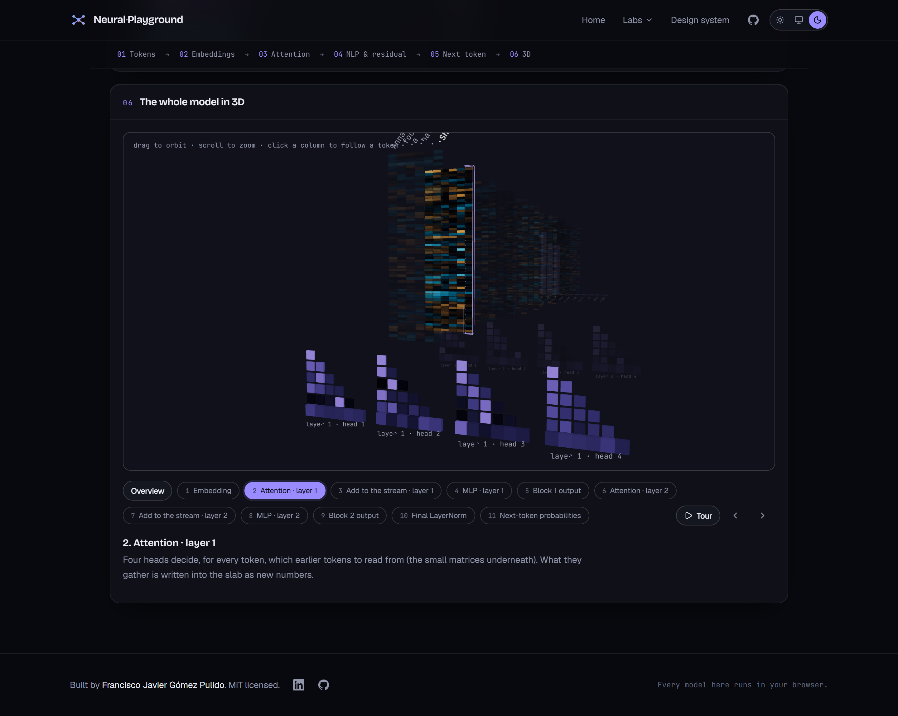
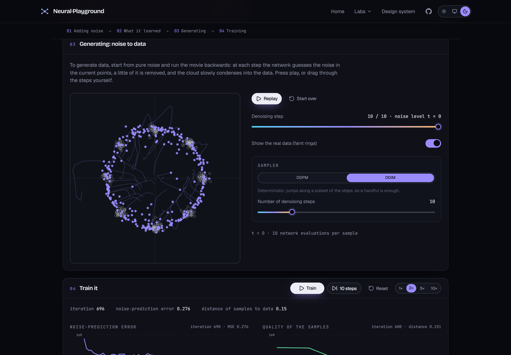
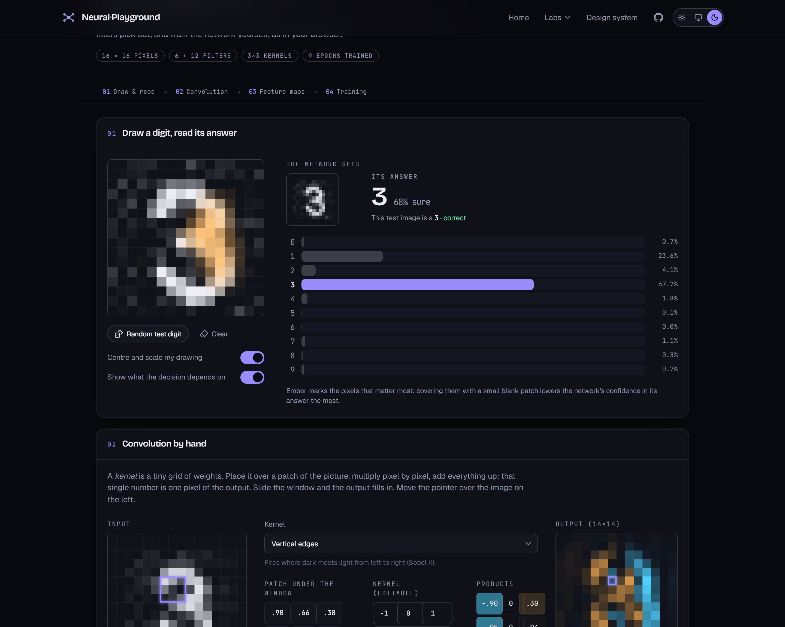
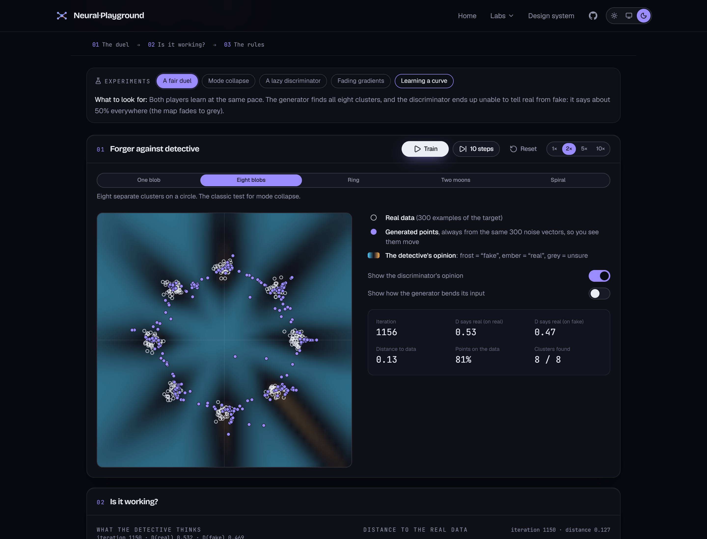
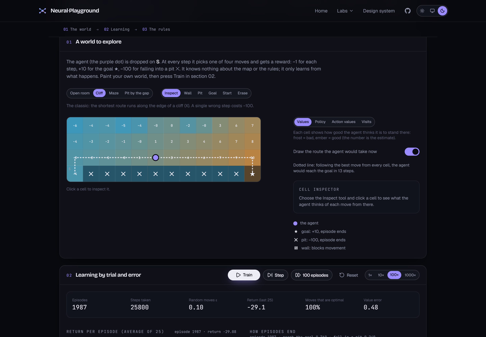

<div align="center">

# 🧠 See Inside ML

**See inside every machine-learning model.** An interactive atlas of 89 labs, from a single neuron to transformers, diffusion models and RLHF: watch models learn, decide and fail, with every engine written from scratch and running entirely in your browser.

[](https://github.com/fragompul/see-inside-ml/actions/workflows/ci.yml)




</div>

## What it is

Most explanations of machine learning stop at a diagram. Here every neuron, weight, split and gradient is something you
can grab, change and watch. Each lab is one idea, with controls, live charts and a set of one-click **experiments**
that each teach one lesson.

- **Built from scratch.** No TensorFlow, no PyTorch, no scikit-learn at runtime: matrices, optimisers, trees, SVMs,
  CNNs, a GPT, diffusion, RL agents… are TypeScript in this repo, so every internal value can be shown.
- **Checked against the real thing.** Where an oracle exists, engines are tested against scikit-learn, statsmodels or
  a Python reference (parity fixtures in `packages/*/fixtures`); neural layers are checked by finite-difference
  gradient tests.
- **Claims are measured.** Every experiment's headline claim is run by the test suite; claims that did not
  reproduce were rewritten rather than kept.
- **Zero friction.** No server, no accounts, no GPU. Heavy computations run in a Web Worker so the page stays
  responsive. Light ("Parchment") and dark ("Obsidian") themes, keyboard accessible, and checked with axe (WCAG 2.x AA)
  on every route in both themes.

## The atlas

| Track                                  | Labs | What is inside                                                                                                                                                                                                                                                                                       |
| -------------------------------------- | :--: | ---------------------------------------------------------------------------------------------------------------------------------------------------------------------------------------------------------------------------------------------------------------------------------------------------- |
| Foundations                            |  1   | One neuron, activation functions, gradient descent on a loss landscape                                                                                                                                                                                                                               |
| Classical supervised                   |  18  | Linear, multiple, logistic regression · k-NN · Naive Bayes, LDA, QDA · polynomials and regularisation · robust regression and GLMs · trees · random forests · AdaBoost · gradient boosting · SVMs · Gaussian processes · Bayesian regression · model showdown · voting and stacking · isotonic, splines, MARS · survival analysis |
| Unsupervised and probabilistic         |  20  | k-means · hierarchical · DBSCAN/OPTICS · mean shift · GMM/EM · spectral · PCA/kernel PCA · anomaly detection · SOM · ICA · NMF · manifold learning · HMM · Kalman and particle filters · MCMC · Bayesian inference · Markov chains and PageRank · forecasting · association rules · recommenders      |
| Evaluation and optimisation            |  8   | Bias-variance · validation and leakage · metrics and thresholds · hyperparameter tuning · optimiser race · feature selection · metaheuristics · constrained optimisation                                                                                                                              |
| Deep learning                          |  9   | MLP playground · CNN · RNN/LSTM/GRU · Transformer explorer (with a 3-D view) · character language model · training toolbox · convolution arithmetic · data augmentation · attention head ablation                                                                                                     |
| Generative models                      |  7   | Autoencoders and VAEs · GANs · diffusion · steering a VAE (conditional, VQ-VAE) · GAN recipes (WGAN-GP) · normalising flows · guidance and flow matching                                                                                                                                              |
| Language                               |  6   | Embeddings (word2vec) · position encodings · KV cache · tokenizers compared (BPE) · n-grams vs a neural LM · retrieval-augmented generation                                                                                                                                                          |
| Reinforcement learning                 |  8   | Q-learning/SARSA gridworld · bandits · policy gradients · Monte Carlo and TD · MCTS · Dyna · actor-critic and GAE · DQN                                                                                                                                                                              |
| Interpretability                       |  5   | Shapley, KernelSHAP, LIME, permutation importance · pixel attribution · adversarial robustness · probing · feature visualisation                                                                                                                                                                     |
| Modern topics                          |  7   | Compression (quantise, prune, distil) · LoRA · scaling laws · mixture of experts · graph neural networks · neural ODEs · learning from human feedback                                                                                                                                                |

The full list, with the caveats, is in [docs/ROADMAP.md](docs/ROADMAP.md).

## A few labs

<table>
  <tr>
    <td width="50%"></td>
    <td width="50%"></td>
  </tr>
  <tr>
    <td align="center"><sub>MLP playground: one training step with the real numbers</sub></td>
    <td align="center"><sub>Transformer explorer: the residual stream in 3-D</sub></td>
  </tr>
  <tr>
    <td width="50%"></td>
    <td width="50%"></td>
  </tr>
  <tr>
    <td align="center"><sub>Diffusion: noise condensing into data</sub></td>
    <td align="center"><sub>CNN: draw a digit, see the feature maps</sub></td>
  </tr>
  <tr>
    <td width="50%"></td>
    <td width="50%"></td>
  </tr>
  <tr>
    <td align="center"><sub>GAN: the generator against the discriminator</sub></td>
    <td align="center"><sub>Reinforcement learning: a paintable gridworld</sub></td>
  </tr>
</table>

Highlights:

- **MLP playground.** Every neuron is a live heat-map over the input plane; add layers, change activations,
  optimisers and regularisation; step through forward → loss → backward → update; the whole setup lives in the URL.
- **Transformer explorer.** A real 2-layer, 4-head GPT (136k parameters) trained from scratch on synthetic stories
  and verified against an independent NumPy implementation to 1e-8: tokens, embeddings, every attention head, the
  residual stream and next-token sampling.
- **Experiments.** Each lab ships a handful of one-click setups ("the RNN forgets", "SARSA takes the safe road",
  "mode collapse", "a penalty is only right in the limit") whose claims are asserted by the test suite.

## Quick start

Requires [Node.js](https://nodejs.org) ≥ 20.19.

```bash
git clone https://github.com/fragompul/see-inside-ml.git
cd see-inside-ml
npm install
npm run dev
```

Open http://localhost:5173. Use the sun / monitor / moon selector in the header to switch themes.

| Command               | What it does                                                           |
| --------------------- | ---------------------------------------------------------------------- |
| `npm run dev`         | Start the dev server with hot reload                                   |
| `npm run build`       | Type-check and create a production build                              |
| `npm run preview`     | Serve the production build locally                                     |
| `npm test`            | Unit and parity tests (Vitest), all packages                           |
| `npm run e2e`         | End-to-end tests (Playwright), including the axe accessibility sweep   |
| `npm run check`       | Format, lint, types, tests, build and bundle budget (what CI runs)     |
| `npm run screenshots -w @sim/web`| Regenerate the README images (dev server running)                      |

## Architecture

```
apps/web/            Vite + React + TypeScript + Tailwind app (design system, lab kit, labs/<track>/<lab>)
packages/core/       Numerics: matrix, RNG, linalg, statistics, metrics, optimisers, metaheuristics, datasets
packages/classic/    Classical ML: regression, trees, ensembles, SVM, GP, clustering, PCA, HMM, MCMC, survival…
packages/deep/       Neural engines: MLP, CNN, RNN, transformer, VAE, GAN, diffusion, flows, RL, MoE, GNN, RLHF…
tools/               Author-time Python and scripts: tiny-GPT pipeline, fixture generators, bundle budget
reference/           The original Python/NumPy implementation, kept as a numerical oracle
docs/                Architecture notes, decisions and the roadmap
```

Labs are registered in `apps/web/src/app/registry.ts` and lazy-loaded; each follows the same pattern (a core that
runs a scenario, a spec with parameters and measured experiments, a page, and a test that runs every claim). See
[docs/ARCHITECTURE.md](docs/ARCHITECTURE.md) and [docs/ROADMAP.md](docs/ROADMAP.md).

## Status

All planned labs are live (89) and `npm run check` and the end-to-end suite pass. Possible future work: refreshed
screenshots for the newest labs and product features that are out of scope for now (a guided learn mode, i18n, PWA,
CSV upload, WebGPU).

## 👤 Author

**Francisco Javier Gómez Pulido**

AI Lead at Aapex. AI Lead & MLOps Architect specialized in building scalable architectures, data science pipelines,
and generating real business impact through production-grade artificial intelligence. Holds a Double Degree in
Mathematics and Computer Science and a Master's degree in Artificial Intelligence.

📫 Let's connect:

- LinkedIn: [linkedin.com/in/frangomezpulido](https://www.linkedin.com/in/frangomezpulido)
- GitHub: [github.com/fragompul](https://github.com/fragompul)
- Email: [frangomezpulido2002@gmail.com](mailto:frangomezpulido2002@gmail.com)

## License

[MIT](LICENSE). If you find this useful, a ⭐ is very welcome.
