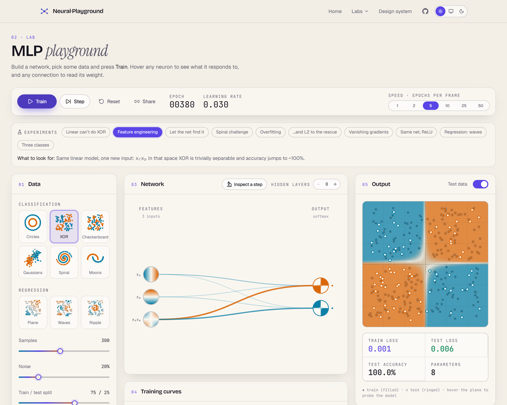

<div align="center">

# 🧠 See Inside ML

**See inside every machine-learning model.** An interactive atlas of classical machine learning and deep learning: watch models learn, decide and fail, built from scratch and running entirely in your browser.

[](https://github.com/fragompul/neural-network-playground/actions/workflows/ci.yml)


</div>

> **Status: active development.** 89 labs are live across foundations, classical supervised and
> unsupervised learning, probabilistic models, evaluation, deep learning, generative models, language,
> reinforcement learning, interpretability and modern topics (compression, LoRA). More deep-learning,
> generative and interpretability labs are still being added; see [PLAN_V2.md](PLAN_V2.md), [docs/ROADMAP.md](docs/ROADMAP.md) (built and pending) and the [roadmap](#roadmap).

## The MLP playground

<table>
  <tr>
    <td width="50%"></td>
    <td width="50%"></td>
  </tr>
  <tr>
    <td align="center"><sub>Anatomy of one training step, with the real numbers</sub></td>
    <td align="center"><sub>Light theme: XOR solved by a linear model plus one engineered feature</sub></td>
  </tr>
</table>

- **See what every neuron sees.** Each node is a live heat-map of its response over the whole input
  plane. Hover it for its bias, strongest incoming weights and activation formula; hover a
  connection to read its weight.
- **Build it as you go.** Add or remove layers and neurons, change each layer's activation, toggle
  input features, switch optimizer, learning rate and schedule, add L1/L2 or skip connections.
  Everything applies live; data and architecture changes rebuild instantly.
- **Inspect one training step.** Pick a sample (by default the one the model gets most wrong) and walk
  through forward pass → loss → backward pass → weight update, with the real numbers on every
  neuron and edge and the maths typeset next to them.
- **Guided experiments.** Ten one-click setups that each teach one idea (linear models and XOR,
  feature engineering, overfitting and L2, vanishing gradients, …). Their claims are covered by tests.
- **Shareable.** The whole setup lives in the URL. Light and dark themes. Fully keyboard accessible
  (<kbd>Space</kbd> train, <kbd>→</kbd> step, <kbd>R</kbd> reset).

## The foundations lab

The start of the path, with nothing hidden: one neuron, the activation functions, and gradient
descent on a loss landscape you can see.

- **One neuron, one line.** Weights and bias as sliders, four activations, four tiny datasets
  (AND, OR, XOR, two clouds). Click a point to see the exact arithmetic; "find the best line" shows
  that 100% is possible everywhere except XOR, where 75% is the limit.
- **Activation functions.** Seven functions with their slopes and the signal that survives ten
  layers: why sigmoid networks stall and ReLU does not.
- **Learning is rolling downhill.** The loss over the two weights as a surface; drop a ball anywhere
  and let SGD, momentum, RMSprop or Adam roll it. Watch a tiny learning rate crawl, momentum race and
  XOR settle on a plateau at ln 2.
- **Why layers.** What one line cannot do, and a way into the MLP playground.
- **Experiments.** Five one-click setups, each verified by the test suite.

## The CNN lab

A small convolutional network that learns to read handwritten digits (16×16 pixels, generated
procedurally so nothing is downloaded), with the convolution, ReLU, pooling and backward pass
written from scratch and checked by finite-difference gradient tests.

- **Draw and read.** Sketch a digit with the mouse or a finger; ten probability bars update on every
  stroke. Optionally centre/scale the drawing the way MNIST was prepared, and switch on an
  occlusion map that paints the pixels the decision depends on.
- **Convolution by hand.** Slide a 3×3 window over the picture and see the patch, the kernel, the
  nine products and their sum. Pick Sobel, blur or sharpen, a filter the network learned, or type
  your own numbers.
- **Feature maps.** What every filter of every layer produces for your drawing, next to the
  kernels themselves, before or after the ReLU.
- **Train it.** Live learning curves, a confusion matrix, and every hyper-parameter (optimizer,
  learning rate, batch size, filters, kernel size, data size, noise) editable while it learns.

## The reinforcement-learning lab

A tabular agent in a gridworld you can paint, with Q-learning, SARSA and Expected SARSA written from
scratch and measured against **value iteration**, which knows the rules and so gives the exact
optimal values the agent has to discover.

- **A world to explore.** Open room, cliff, maze and a pit by the gap, or paint your own with
  walls, pits, goals and a start. See the learned values, the policy arrows, all four action values
  per cell, or the visit counts; inspect any cell and compare with its optimal value.
- **Learning by trial and error.** Episode return, how episodes end, closeness to the optimal moves
  and the exploration rate, live, at up to 1000 steps per frame.
- **The rules.** Algorithm (with its update rule typeset), learning rate, discount, ε and its decay,
  slippery floor, step reward.
- **Experiments.** Five one-click setups (Q-learning on the cliff, SARSA takes the safe road, an
  agent with no foresight, learning too slowly, finding a way through a maze), each verified by
  the test suite.

## The embeddings lab

Word2vec (skip-gram with negative sampling) trained from scratch on a made-up world of kings and
queens, countries and capitals, animals and food, with every gradient written by hand and checked
against finite differences. The corpus is generated from templates, so it is infinite, licence-free
and built to contain real structure (gender, royalty, country → capital).

- **From text to pairs.** Step through sentences, pick a centre word and see exactly which
  (centre, context) pairs and random negatives it produces.
- **The map of meaning.** Every word on the plane of its two main axes, evolving as it trains:
  untrained scatter becomes families (animals, capitals, food, royalty…).
- **Nearest neighbours.** Cosine similarity, closest words and a two-word comparison.
- **Arithmetic with meaning.** `king − man + woman`: a calculator for "a is to b as c is to ?",
  with the arrows drawn on the map and accuracy over 54 analogy questions.
- **Train it.** Loss, family purity and analogy accuracy curves, plus dimension, window, negatives,
  learning rate (high enough and it visibly explodes) and corpus size.
- **Experiments.** Six one-click setups (company shapes meaning, king − man + woman, capitals are a
  direction, a narrow window, too few dimensions, a learning rate that is too high), each verified
  by the test suite.

## The diffusion lab

A denoising diffusion model on 2-D data: noise schedules, a denoiser network that predicts the
added noise, and DDPM and DDIM samplers, all from scratch. The samplers are verified against the
exact optimal denoiser for Gaussian data, and the denoiser's gradients against finite differences.

- **Adding noise.** Drag a time slider (or play it) and watch real data dissolve into a round cloud,
  with the signal/noise curves of the chosen schedule (linear or cosine) next to it.
- **What the network learned.** The model's arrows over the plane at any noise level: the direction
  that makes a point more likely to be data.
- **Generating.** Replay the movie backwards: noise condenses into the data, with the paths of
  individual points. Switch between DDPM (all steps, stochastic) and DDIM (a few steps,
  deterministic) and see how few steps are enough.
- **Train it.** Noise-prediction error, a sample-quality distance, and live controls for T,
  schedule, network size, learning rate and the target distribution.
- **Experiments.** Five one-click setups (one step is not enough, skipping steps with DDIM, early
  training, learning a curve, a gentler schedule); the test suite runs each one and checks it.

## The GAN lab

A generator and a discriminator on two-dimensional data, with both networks and both generator
losses (non-saturating and minimax) written from scratch and gradient-checked, including the
gradient that flows from the discriminator back through the generator.

- **The duel.** Real points, the generator's points (always from the same noise, so you watch them
  move) and the discriminator's opinion over the whole plane. Five targets: one blob, eight blobs,
  ring, two moons, spiral. Optionally draw the grid of noise the generator bends.
- **Is it working?** Charts for what the detective thinks, a real quality measure (sliced
  Wasserstein distance), the losses (which say little) and the gradient the generator receives.
- **The rules.** The losses typeset, and every knob live: both learning rates, discriminator steps
  per generator step, loss variant, batch size, network and noise size.
- **Experiments.** Five one-click setups (a fair duel, mode collapse, a lazy discriminator, fading
  minimax gradients, learning a curve); the test suite runs each one and checks its claim.

## The autoencoder and VAE lab

Plain, denoising and variational autoencoders on the same procedural digits, with the encoder,
decoder, reparameterisation trick and KL term all written from scratch (gradient-checked against
finite differences).

- **Squeeze and rebuild.** Draw or pick a digit and see its code (a handful of numbers), the
  decoder's reconstruction and the error map. Add noise to the input to watch a denoiser work.
- **The latent space.** Every test digit placed by its code, with the decoder's pictures painted
  behind the dots. Drag a probe over the map to decode any point, or pick which latent axes to plot.
  For a VAE the prior N(0, 1) is drawn too.
- **Interpolation and imagination.** Fade two digits in pixel space versus walking between their
  codes, and decode random codes from the prior: a VAE imagines convincing digits, a plain
  autoencoder mostly smudges.
- **Train it.** Curves for reconstruction and KL, autoencoder vs VAE, code size, β, denoising
  noise, optimizer and more, all live.
- **Experiments.** Four one-click setups (the bottleneck, cleaning noise, a map you can sample,
  too much regularisation), each claim verified by the test suite.

## The recurrent-network lab

Vanilla RNN, LSTM and GRU cells with a hand-written backpropagation through time, checked by
finite-difference gradient tests for all three. Small sequence tasks make each cell's strengths
and weaknesses visible.

- **Tasks.** Remember the first symbol, pick the symbol after a ★, tell even from odd. Click any
  token to change the sequence and see the rule's answer and the network's.
- **Unrolled in time.** One column per step: the token, the hidden state of every neuron, the LSTM
  cell state and every gate (forget, input, output, update, reset), and the learning signal
  reaching that step. Hover a column for a plain-language reading of its gates.
- **Vanishing gradients, measured.** Learning signal per step for an untrained RNN, GRU and LSTM on
  a log axis, plus the live network as it trains.
- **Train it.** Curves, confusion matrix, optimizer, learning rate, batch size, gradient
  clipping, hidden size, and a sweep of how the network copes with other sequence lengths.
- **Experiments.** Five one-click setups (short memory is easy, the RNN forgets, gates fix it,
  …). Each claim is verified by running it in the test suite.

## The Transformer explorer

A real GPT, small enough to open up completely: same architecture as GPT-2 (2 layers, 4 heads,
136k parameters), trained from scratch on synthetic stories and running entirely in your browser.
Every number on screen comes from a forward pass written in this repo and checked against an
independent NumPy implementation to 1e-8.

- **Tokens.** Type anything; see the byte-level BPE tokens and ids, and replay how BPE fuses the
  bytes of a word, even one the model never saw.
- **Embeddings.** The vector of every token, the position embeddings, and a PCA map of the whole
  vocabulary: nobody told the model which words are names or animals, yet they cluster.
- **Attention.** All heads of every layer, a full attention matrix with the `q·k/√d` maths of any
  cell on hover, and the causal mask made visible.
- **Residual stream and MLP.** Watch one token's vector grow as attention and the MLP add to it,
  and see which MLP neurons wake up (with the GELU curve under them).
- **The whole model in 3D.** The residual stream as a tunnel of slabs (a column per token, a cell per
  number), attention heads hanging under their layer, and the next-token probabilities standing at
  the end. Fly through it with a guided tour, orbit freely, hover any cell for its value, click a
  column to follow one token everywhere.
- **Next token.** The model's probability for every token, with live temperature, top-k and top-p,
  entropy, click-to-choose and auto-generation. Every step is deterministic for a seed.

## Why

Most explanations of neural networks stop at a diagram. Here every neuron, weight and gradient is
something you can grab, change and watch, from a single perceptron to transformers and diffusion
models. Nothing is a black box: the math engine is written from scratch (no TensorFlow, no PyTorch)
so every internal value can be exposed and visualized.

- **For learners:** guided, interactive, beginner → advanced. Hover for the math, drag to change,
  pause and step through forward and backward passes.
- **Zero friction:** no server, no accounts, no GPU required. Clone, install, run.

## Quick start

Requires [Node.js](https://nodejs.org) ≥ 20.19.

```bash
git clone https://github.com/fragompul/neural-network-playground.git
cd neural-network-playground
npm install
npm run dev
```

Open http://localhost:5173. Use the sun / monitor / moon selector in the header to switch between
the light ("Parchment") and dark ("Obsidian") themes.

| Command             | What it does                                         |
| ------------------- | ---------------------------------------------------- |
| `npm run dev`       | Start the dev server with hot reload                 |
| `npm run build`     | Type-check and create a production build             |
| `npm run preview`   | Serve the production build locally                   |
| `npm test`          | Unit tests (Vitest)                                  |
| `npm run e2e`       | End-to-end tests (Playwright)                        |
| `npm run check`     | Format, lint, types, tests and build (what CI runs)  |
| `npm run screenshots` | Regenerate the README images (dev server running)  |

## Learning path

Modules are ordered pedagogically; each one builds on the previous.

Labs are grouped in tracks (Foundations, Classical ML, Evaluation, Deep learning, Generative,
Language, Reinforcement learning, Interpretability, Modern topics); the Labs menu lists them.

| #   | Module                 | Status       |
| --- | ---------------------- | ------------ |
| 00  | Linear regression      | **Live**     |
| 01  | Foundations            | **Live**     |
| 02  | MLP Playground         | **Live**     |
| 03  | Convolutional Networks | **Live**     |
| 04  | RNNs, LSTMs & GRUs     | **Live**     |
| 05  | Transformers & LLMs    | **Live**     |
| 06  | Autoencoders & VAEs    | **Live**     |
| 07  | GANs                   | **Live**     |
| 08  | Diffusion Models       | **Live**     |
| 09  | Embeddings & NLP       | **Live**     |
| 10  | Reinforcement Learning | **Live**     |

## Architecture

```
apps/web/            Vite + React + TypeScript + Tailwind app (design system, lab kit, labs/<track>/<lab>)
packages/core/       Shared numerics: matrix, RNG, linalg, statistics, metrics, estimator interfaces, datasets
packages/classic/    Classical ML models (linear regression so far), validated against scikit-learn/statsmodels
packages/deep/       Neural engines: MLP, CNN, RNN/LSTM/GRU, autoencoder/VAE, GAN, diffusion, word2vec, RL, tiny GPT
tools/               Author-time Python: tiny-GPT pipeline, fixture generators, dataset export
reference/           Original Python/NumPy implementation, kept temporarily as a numerical oracle
docs/                Architecture notes and decisions
```

See [docs/ARCHITECTURE.md](docs/ARCHITECTURE.md) and [PLAN.md](PLAN.md) for details.

## Roadmap

- [x] **Phase 0:** monorepo, design system (light + dark), animated landing, CI
- [x] **Phase 1:** TypeScript ML engine (MLP, 4 optimizers, datasets, Web Worker session) verified against the NumPy reference and by gradient checks
- [x] **Phase 2:** MLP Playground v2 (interactive graph, neuron heat-maps, step inspector, experiments, shareable URLs)
- [x] **Phase 2.5:** loss-landscape view, drag-to-add data points, weight/gradient histograms
- [x] **CNN:** adversarial examples (FGSM, PGD) and Grad-CAM / evidence maps
- [x] **Phase 4a:** Transformer explorer (tiny GPT trained from scratch, BPE, attention, embeddings, sampling)
- [x] **Phase 4b:** CNN lab (digits, convolution explainer, feature maps, training, occlusion)
- [x] **Phase 4c:** recurrent lab (RNN, LSTM, GRU, BPTT, gates, vanishing gradients)
- [x] **Phase 4d:** autoencoder and VAE lab (latent map, interpolation, denoising, β)
- [x] **Phase 4e:** GAN lab (duel plane, mode collapse, minimax vs non-saturating)
- [x] **Phase 4f:** diffusion lab (noising, score field, DDPM/DDIM sampling)
- [x] **Phase 4g:** embeddings lab (word2vec, map, neighbours, analogies)
- [x] **Phase 4h:** reinforcement-learning lab (gridworld editor, Q-learning / SARSA, value iteration)
- [x] **Phase 4i:** foundations lab (neuron, activations, gradient descent on a loss landscape)
- [x] **Expansion phase 0:** rename, three packages (core / classic / deep), track registry, lab kit, first classical lab, Pages deploy workflow
- [x] **Expansion phases 1–5:** classical supervised and unsupervised catalogue, probabilistic models, evaluation and optimisation
- [ ] **Expansion phases 6–9:** deeper deep-learning, generative and language labs, interpretability, modern topics, hardening (see [PLAN_V2.md](PLAN_V2.md))

## Author

**Francisco Javier Gómez Pulido**: Machine Learning Engineer @ IMSE-cnm (CSIC) · Double degree in
Mathematics & Computer Science · MSc in Artificial Intelligence

[LinkedIn](https://www.linkedin.com/in/frangomezpulido) · [GitHub](https://github.com/fragompul) · [Email](mailto:frangomezpulido2002@gmail.com)

## License

[MIT](LICENSE). If you find this useful, a ⭐ is very welcome.
